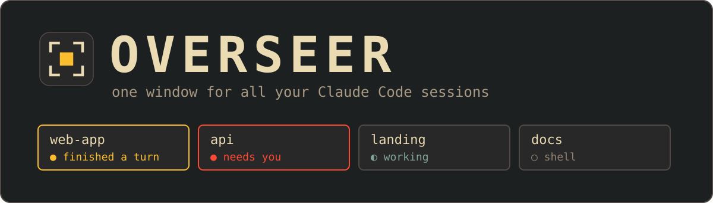

<p align="center">
  
</p>

<p align="center">
  <a href="LICENSE"></a>
  
  
  
</p>

<h3 align="center">Run many Claude Code sessions side by side and always know which one needs you</h3>

<p align="center">
  A desktop terminal whose tabs turn <b>gold</b> when Claude finishes and <b>red</b> when it waits for you,<br>
  plus one extra Claude, the overseer, that can see every tab at once.
</p>

<br>


## ◆ The problem it solves

You have Claude Code running in six terminal tabs across four repos. One finished ten minutes ago, one has been sitting on a permission prompt, and the only way to find out is to click through every tab.

Overseer shows you at a glance. And when you have lost track of what all those sessions were doing, you press <kbd>Ctrl</kbd> <kbd>W</kbd> and ask.

## ◆ What you get

#### ▸&nbsp; Tabs that wrap
Tabs sit on top and wrap onto a second row, so there is never a sideways scroll. Each tab is your own shell: <code>cd</code> anywhere, run <code>claude</code>, <code>opencode</code>, <code>npm</code> or anything else.

#### ●&nbsp; Gold and red tabs
A tab turns gold when its Claude finishes a turn while you are in another tab. It turns red when Claude is waiting on you, for a permission or a question. Open the tab and the color clears.

#### ◆&nbsp; The overseer
Press <kbd>Ctrl</kbd> <kbd>W</kbd> and a Claude (Opus) opens next to your tabs. It knows every tab: its folder, what runs there, the last screen of text and the Claude transcript. It sleeps until you wake it, so it costs nothing while idle.

#### ▤&nbsp; Status column
Your 5 hour and weekly usage, effort, model and time worked today. Under it RAM, disk, battery and uptime.

#### ↻&nbsp; Pick up where you left off
After a restart every tab comes back as a shell in its last folder, with a <b>Continue</b> button that resumes the exact Claude session that ran there.

#### ▾&nbsp; Lives in the tray
Closing the window only hides it, and every tab keeps running. <kbd>Alt</kbd> <kbd>W</kbd> shows or hides it from anywhere, like a drop-down terminal.

#### ⇣&nbsp; Drop files in
Drop a file on a terminal and its path is pasted. Claude Code turns an image path into an attached image.

## ◆ The overseer


It is a normal Claude Code session, so every command, skill and MCP server you use works there too. Things to ask it:

- ▸ *"What is each tab doing?"*
- ▸ *"Which tab is stuck?"*
- ▸ *"What was I doing in the api repo two hours ago?"*
- ▸ *"These two tabs are about the same feature, open one new tab that continues both."*

## ◆ Quick start

**You need:** Linux, Node 20 or newer, and Claude Code installed and signed in the usual way.

```bash
git clone https://github.com/0xGondarxyz/overseer
cd overseer
npm install
npx electron .
```

**Optional extras**

1. Add Overseer to your app menu: `scripts/install-launcher.sh`
2. Show or hide it with <kbd>Alt</kbd> <kbd>W</kbd> from anywhere: bind a global shortcut to `bin/overseer-toggle`. On KDE that is System Settings, Shortcuts, add a command shortcut with the full path to that file. It starts the app if it is not running, and on KDE it also moves the window to the monitor under your mouse.

> [!NOTE]
> Tested on KDE Plasma. Other Linux desktops should run it, but the <kbd>Alt</kbd> <kbd>W</kbd> window move is KDE only. macOS and Windows are untested.

## ◆ Keys

| Keys | What happens |
|---|---|
| <kbd>Alt</kbd> <kbd>W</kbd> | Show or hide the whole app (global shortcut) |
| <kbd>Ctrl</kbd> <kbd>W</kbd> | Wake or hide the overseer |
| <kbd>Shift</kbd> <kbd>←</kbd> / <kbd>Shift</kbd> <kbd>→</kbd> | Previous or next tab |
| <kbd>Ctrl</kbd> <kbd>Shift</kbd> <kbd>T</kbd> / <kbd>Ctrl</kbd> <kbd>Shift</kbd> <kbd>W</kbd> | New tab or close tab |
| <kbd>F2</kbd> | Rename the tab |
| <kbd>Ctrl</kbd> <kbd>Shift</kbd> <kbd>C</kbd> / <kbd>Ctrl</kbd> <kbd>Shift</kbd> <kbd>V</kbd> | Copy or paste |
| <kbd>Ctrl</kbd> <kbd>=</kbd> / <kbd>Ctrl</kbd> <kbd>-</kbd> / <kbd>Ctrl</kbd> <kbd>0</kbd> | Zoom in, out or reset |
| Middle-click a tab | Close it (asks first if something is still running) |
| Drag a tab | Reorder tabs |

## ◆ How it works

1. **Every tab is a real terminal** running your login shell. When you type `claude`, a small wrapper adds `--settings` (hooks) and `--plugin-dir` (a usage bridge) and then runs the official `claude` binary.
2. **Claude Code's own hooks** report back to the app over a local socket. `Stop` turns a tab gold. A permission `Notification`, or Claude asking you a question, turns it red.
3. **When you wake the overseer**, the app writes a summary of every tab to a file in `~/.cache/overseer` (folder, what runs there, the last 40 lines on screen, the transcript path) and starts `claude --model opus` pointed at it.

## ◆ How it stays inside Anthropic's terms

> [!IMPORTANT]
> Overseer is a terminal. It never touches your Claude login.

- **You install Claude Code yourself** and sign in through Claude's own login. Overseer never bundles or modifies the `claude` binary, and every tab runs the official, unmodified one. Anthropic's [legal and compliance page](https://code.claude.com/docs/en/legal-and-compliance) allows signing in to the unmodified Claude Code binary with your own subscription.
- **No credentials, no API calls.** The app never reads, stores or forwards credentials or session tokens. It never calls Anthropic's API itself and does not use the Agent SDK.
- **Documented features only.** It talks to Claude Code through `--settings` hooks for the gold and red tabs, and a plugin that reads the status-line usage numbers.
- **You answer the prompts.** The overseer can type into another tab only when you ask it to. It can never answer a tab that is waiting on a permission prompt or a question; the app refuses that. This is the same boundary Claude Code keeps for its own cross-session messages.

## ◆ Contributing

Issues and pull requests are welcome. Overseer has only been tested on KDE Plasma, so reports and fixes from GNOME, other desktops and macOS help the most.

```bash
node --test test/unit/
node --test --test-concurrency=1 test/e2e/app.spec.js
```

The end-to-end tests need a display and `fish` installed. They run hidden windows with a fake `claude` (`test/fake-claude.js`), so they never start a real session. `node scripts/readme-shots.js` rebuilds the screenshots above from demo tabs.

## ◆ License

MIT, see [`LICENSE`](LICENSE).

<br>

<p align="center"><sub>Overseer is an independent project and is not affiliated with or endorsed by Anthropic.</sub></p>
