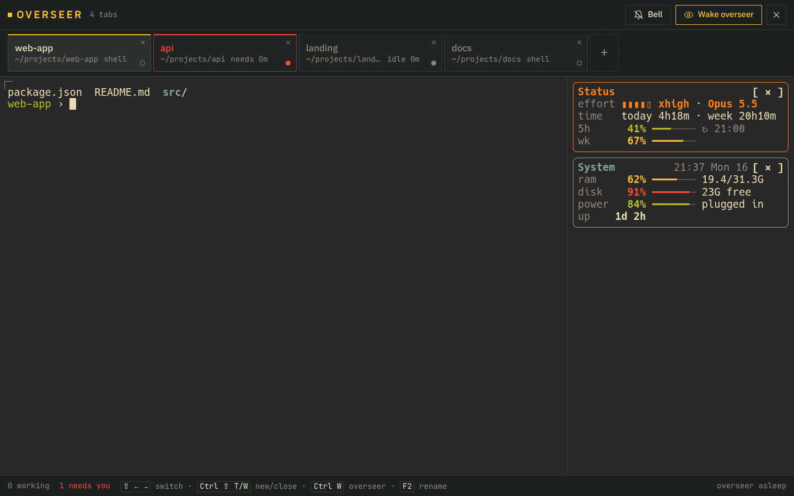
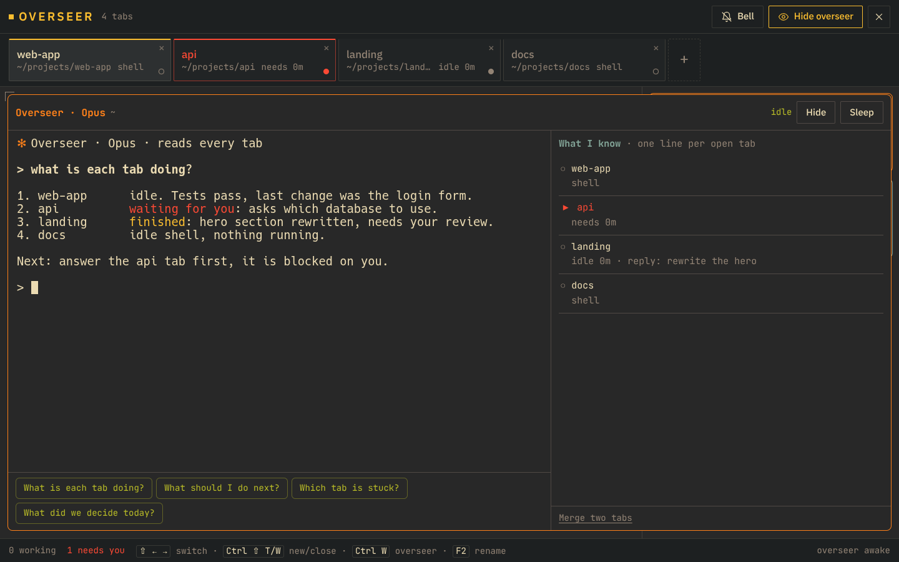

# Overseer

A desktop terminal for people who run many coding-agent sessions at once. Every tab is a normal shell, and one extra session, the overseer, can see all of them.



## What it does

- **Tabs that wrap.** Tabs sit on top and wrap onto a second row, so there is never a sideways scroll. Each tab is your own shell, so you can `cd`, run `claude`, `opencode`, `npm` or anything else.
- **Attention signals.** A tab turns gold when its Claude finishes a turn while you are looking at another tab. It turns red when Claude is waiting on you, for a permission or a question. Switching to the tab clears it.
- **The overseer.** Press `Ctrl+W` to wake a Claude (Opus) that knows every open tab: what runs there, its folder, the last screen of text, and the Claude transcript. Ask it "what is each tab doing?" or "which tab is stuck?". It sleeps until you wake it, so it costs nothing while idle.
- **Status column.** Two boxes. Status shows usage (5 h and weekly limits), effort, model and time worked today. System shows RAM, disk, battery and uptime.
- **Pick up where you left off.** After a restart every tab comes back as a shell in its last folder, with a **Continue** button for the Claude session that ran there.
- **Lives in the tray.** Closing the window hides it, and every tab keeps running. `Alt+W` shows or hides it from anywhere, like a drop-down terminal.



## Keys

| Key | Action |
|---|---|
| `Alt+W` | Show or hide the whole app (global shortcut) |
| `Ctrl+W` | Wake or hide the overseer |
| `Shift+←` / `Shift+→` | Previous or next tab |
| `Ctrl+Shift+T` / `Ctrl+Shift+W` | New tab or close tab |
| `F2` | Rename the tab |
| `Ctrl+Shift+C` / `Ctrl+Shift+V` | Copy or paste |
| `Ctrl+=` / `Ctrl+-` / `Ctrl+0` | Zoom in, out or reset |
| Middle-click a tab | Close it (asks first if something is running) |
| Drop a file on a terminal | Pastes its path; Claude Code turns an image path into an attached image |

## Run it

Needs Linux, Node 20+, and Claude Code installed and signed in as usual (see the terms section below).

```bash
git clone https://github.com/0xGondarxyz/overseer
cd overseer
npm install
npx electron .
```

Optional: run `scripts/install-launcher.sh` to add Overseer to your app menu.

To show or hide it with `Alt+W`, bind a global shortcut to `bin/overseer-toggle` (on KDE: System Settings, Shortcuts, add a command shortcut with the full path to that file). It starts the app if it is not running, and on KDE it moves the window to the monitor under the mouse.

## How it stays inside Anthropic's terms

Overseer is a terminal. It never touches your Claude login.

- You install Claude Code yourself and sign in through Claude's own login. Overseer never bundles or modifies the `claude` binary; every tab runs the official, unmodified one.
- The app never reads, stores or forwards credentials or session tokens. It never calls Anthropic's API itself and does not use the Agent SDK.
- It talks to Claude Code only through documented features: `--settings` hooks for the gold and red signals, and a plugin that reads the status-line usage numbers.
- The overseer can type into another tab only when you ask it to. It can never answer a tab that is waiting on a permission prompt or a question; the app refuses that. This is the same boundary Claude Code keeps for its own cross-session messages.

Overseer is an independent project and is not affiliated with or endorsed by Anthropic.

## Tests

```bash
node --test test/unit/
node --test --test-concurrency=1 test/e2e/app.spec.js
```

The end-to-end tests need a display and `fish` installed. They run hidden windows with a fake `claude` (`test/fake-claude.js`), so they never use a real session. `node scripts/readme-shots.js` rebuilds the screenshots above from demo tabs.

## License

MIT, see `LICENSE`.
